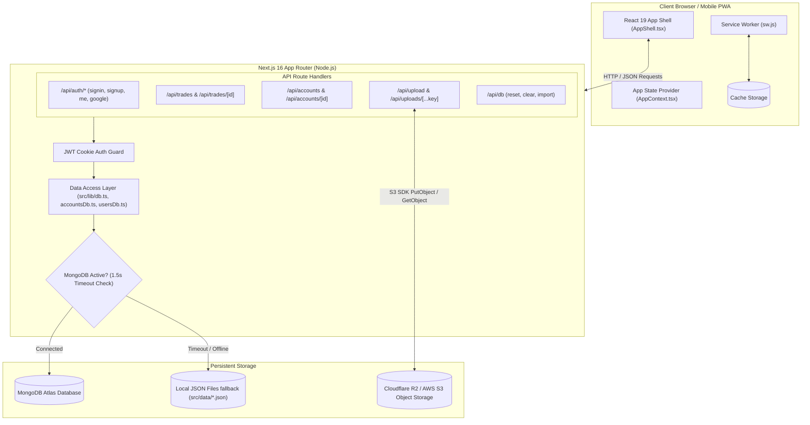

# 📊 AlphaTrader — Professional Trading Journal & Analytics PWA

AlphaTrader is a fullstack, offline-ready Progressive Web Application (PWA) built with **Next.js 16 (App Router)**, **React 19**, **TypeScript**, **Mongoose / MongoDB**, and a custom **Vanilla CSS** design system. Designed specifically for active retail and prop-firm traders (Forex, Crypto, Stocks, and Futures), it tracks execution metrics, risk-to-reward ratios, visual chart screenshots, and behavioral psychology to eliminate cognitive trading biases and optimize profitability.

---

## 📑 Table of Contents

- [Key Features](#-key-features)
- [System Architecture](#-system-architecture)
- [Technology Stack](#-technology-stack)
- [Directory Structure](#-directory-structure)
- [Data Models & Schema](#-data-models--schema)
- [API Reference](#-api-reference)
- [Environment Variables & Configuration](#-environment-variables--configuration)
- [Installation & Getting Started](#-installation--getting-started)
- [Resilience & Fallback Architecture](#-resilience--fallback-architecture)
- [Progressive Web App (PWA)](#-progressive-web-app-pwa)
- [License](#-license)

---

## 🚀 Key Features

### 1. 💼 Multi-Account & Prop Firm Management
- Seamlessly track separate accounts (e.g., FTMO 100k, Apex Trader Funding, TopStep, Personal Live, Demo).
- Configure starting balance and currency for each portfolio.
- Dynamic global filter: switch between individual accounts or view a unified **"All Accounts"** aggregated portfolio.

### 2. 📝 Comprehensive Trade Logging Wizard (4-Step Modal)
- **Step 1: Trade Setup & Execution**:
  - Asset class selector: **Forex** (100,000 unit standard contracts), **Crypto**, **Stocks**, and **Futures**.
  - Major pair suggestions (`EURUSD`, `GBPUSD`, `USDJPY`, `BTCUSD`, `GOLD`, `SPY`, etc.) or custom ticker input.
  - Direction (**Long** / **Short**) and Order Type (**Market**, **Limit**, **Stop**).
  - Trading Strategy tag, Execution Timeframe (1m up to 1D), Broker, and Trading Session (**London**, **New York**, **Asia**, **Sydney**).
  - Position sizing calculator: dynamic real-time Risk Amount ($), Risk Percentage (%), and Planned Risk-to-Reward (R:R).
- **Step 2: Results & P&L**:
  - Mark trades as **Active (Live)** or **Closed**.
  - Automatic P&L calculation based on lot size, contract multiplier, entry price, and exit price.
  - Trade duration auto-calculation (e.g., `2h 45m`, `1d 4h`).
  - Qualitative notes: Entry Reason and Post-Trade Lessons Learned.
- **Step 3: Psychology & Discipline Tracker**:
  - Longitudinal emotional tracking across 3 distinct phases: **Before Trade**, **During Trade**, and **After Exit** (`Calm`, `Confident`, `Fearful`, `Greedy`, `Anxious`, `Frustrated`, `Neutral`).
  - Discipline & Bias tags: identify patterns like `FOMO`, `Revenge Trading`, `Overconfidence`, `Impatience`, `Patience`, and `Discipline`.
  - Mistakes checklist to capture plan deviations.
- **Step 4: Chart Screenshot Attachments**:
  - Upload Before/After trade setup screenshots directly from clipboard or disk.
  - Stored securely in Cloudflare R2 / S3 with user-isolated paths and streaming proxy endpoints.

### 3. 📈 Interactive Performance Dashboard
- **Glowing Vector Equity Curve**: Custom-drawn, dynamic SVG performance line charting cumulative account growth over time with interactive coordinate tooltips.
- **Circular Progress Metric Rings**: Visual percentage ring gauges for Win Rate and Profit Factor.
- **Core Key Performance Indicators (KPIs)**:
  - Net Realized P&L
  - Win Rate % (Wins vs. Losses)
  - Profit Factor (Gross Profits / Gross Losses)
  - Expectancy ($ return expected per dollar risked)
  - Average Win ($) vs. Average Loss ($)
  - Realized R-Multiple average
- **Recent Trades Feed**: Quick overview of recent closed and open positions with direct modal drill-down.

### 4. 🧠 Advanced Analytics Engine
- **Overview Metrics**:
  - Expected Value (EV) per trade ($).
  - **Kelly Criterion** optimal position sizing suggestion (%).
  - Maximum Consecutive Win Streak & Loss Streak.
  - Maximum Single Win & Maximum Single Drawdown.
- **Strategy Performance Matrix**: Breakdown of win rate, net P&L, trade frequency, and profit factor per strategy.
- **Session & Asset Analysis**: Profitability categorized by trading session (London, New York, Asia) and asset type.
- **Psychology Correlation**: Visual financial impact analysis demonstrating exactly how much money each emotion and psychological trigger (e.g., FOMO vs. Discipline) earned or lost.

### 5. 🖼️ Visual Trade Gallery & Directory
- Filter trades by **Active (Live)**, **Closed**, or switch into **Gallery View** to inspect pure technical chart setups side-by-side.
- Powerful multi-parameter filtering: by asset class, direction, status, session, strategy, or free-text search.
- Sort by Newest, Oldest, P&L (High to Low), P&L (Low to High), or Risk-to-Reward.

### 6. 💾 Data Portability & Disaster Recovery
- **JSON Export**: Download a full JSON snapshot of your trading records for offline archiving or spreadsheet analysis.
- **JSON Import**: Restore or migrate backups instantly.
- **One-Click Demo Reset**: Populate realistic demo trades across multiple asset classes for testing.
- **Wipe History**: Clean all trades with confirmation modal protection.

---

## 🏛️ System Architecture



---

## 💻 Technology Stack

| Layer | Technology | Details |
|---|---|---|
| **Framework** | Next.js 16.2.9 | App Router, Server Route Handlers, Turbopack support |
| **UI Library** | React 19.2.4 | Client components, Hooks, Context API |
| **Language** | TypeScript 5 | Strict typing throughout frontend, backend, and schemas |
| **Styling** | Vanilla CSS | Custom design system (`globals.css`), CSS variables, glassmorphism |
| **Typography** | Geist Sans & Geist Mono | Next.js Google Font optimization |
| **Database** | MongoDB Atlas & Mongoose 9.7 | Primary distributed document database |
| **Local Fallback** | Node.js File System (`fs`) | Zero-configuration JSON file storage (`src/data/*.json`) |
| **Object Storage** | Cloudflare R2 / AWS S3 (`@aws-sdk/client-s3`) | High-speed chart screenshot storage with private streaming proxy |
| **Authentication** | JWT (`jsonwebtoken`) & `bcryptjs` | HTTP-only cookie-based sessions & password hashing |
| **Social Auth** | Google OAuth Identity Services | Token verification with fallback demo mock token support |
| **Feedback UI** | `react-hot-toast` | Custom styled status notifications and action toasts |
| **Offline / PWA** | Web Manifest & Service Worker | Installable on iOS/Android, standalone desktop window |

---

## 📁 Directory Structure

```text
tradingjournalapp/
├── public/
│   ├── icon.svg                     # Glowing neon candlesticks brand icon (any size)
│   ├── manifest.json                # PWA manifest metadata (standalone, theme colors)
│   └── sw.js                        # Service worker for offline asset caching
├── src/
│   ├── app/
│   │   ├── analytics/
│   │   │   └── page.tsx             # Analytics tab route
│   │   ├── api/
│   │   │   ├── accounts/
│   │   │   │   ├── [id]/route.ts    # PUT, DELETE individual trading account
│   │   │   │   └── route.ts         # GET, POST accounts
│   │   │   ├── auth/
│   │   │   │   ├── google/route.ts  # Google OAuth ID token verification & user upsert
│   │   │   │   ├── me/route.ts      # Active session inspector (verifies cookie JWT)
│   │   │   │   ├── signin/route.ts  # Email/password authentication & cookie creation
│   │   │   │   ├── signout/route.ts # Clears session cookie
│   │   │   │   └── signup/route.ts  # User registration with bcrypt hashing
│   │   │   ├── db/
│   │   │   │   └── route.ts         # Data admin endpoints (reset, clear, import)
│   │   │   ├── trades/
│   │   │   │   ├── [id]/route.ts    # PUT (update) and DELETE trade by ID
│   │   │   │   └── route.ts         # GET (list) and POST (create) trade endpoints
│   │   │   ├── upload/
│   │   │   │   └── route.ts         # S3 / Cloudflare R2 image upload endpoint
│   │   │   └── uploads/
│   │   │       └── [...key]/route.ts# Authenticated image streaming proxy with user check
│   │   ├── settings/
│   │   │   └── page.tsx             # Profile and database management route
│   │   ├── trades/
│   │   │   └── page.tsx             # Trades directory & gallery route
│   │   ├── globals.css              # Custom Vanilla CSS design system & tokens
│   │   ├── layout.tsx               # Root layout, Google Font loader, Toast provider
│   │   └── page.tsx                 # Home route displaying DashboardView
│   ├── components/
│   │   ├── AccountManagerModal.tsx  # Multi-account management modal (create, edit, delete)
│   │   ├── AnalyticsView.tsx        # Expectancy, Kelly Criterion, streaks, psychology charts
│   │   ├── AppShell.tsx             # Responsive layout shell (Sidebar, Header, Bottom Nav)
│   │   ├── AuthView.tsx             # Login / Registration / Google Sign-In interface
│   │   ├── DashboardView.tsx        # Visual equity curve, metric cards, recent trades
│   │   ├── Icons.tsx                # Dependency-free lightweight SVG icon library
│   │   ├── ProfileView.tsx          # Account details, backup import/export, reset controls
│   │   ├── PwaRegister.tsx          # Client-side service worker registration
│   │   ├── TradeDetailModal.tsx     # Full modal drawer for reviewing single trade retro
│   │   ├── TradeModal.tsx           # 4-step wizard for logging & updating trades
│   │   └── TradesView.tsx           # Searchable directory, multi-filters & chart gallery
│   ├── context/
│   │   └── AppContext.tsx           # Global state manager for trades, accounts, and session
│   ├── data/
│   │   ├── accounts.json            # Local JSON fallback store for accounts
│   │   ├── db.json                  # Local JSON fallback store for trades
│   │   └── users.json               # Local JSON fallback store for user credentials
│   ├── lib/
│   │   ├── accountsDb.ts            # Local file-based data access layer for accounts
│   │   ├── auth.ts                  # Password hashing, JWT verification, Google token helper
│   │   ├── db.ts                    # Resilient hybrid MongoDB/JSON Trade repository
│   │   ├── mongodb.ts               # Mongoose connection pooling & caching utility
│   │   ├── toast.tsx                # Custom toast confirmation dialog helper
│   │   └── usersDb.ts               # Local file-based data access layer for users
│   └── models/
│       ├── Account.ts               # Mongoose schema for trading accounts
│       ├── Trade.ts                 # Mongoose schema for trade records
│       └── User.ts                  # Mongoose schema for user accounts
├── .env                             # Environment configuration (see template below)
├── next.config.ts                   # Next.js configuration
├── package.json                     # Project manifest and scripts
├── tsconfig.json                    # TypeScript compiler configuration
└── walkthrough.md                   # Feature overview walkthrough
```

---

## 🗄️ Data Models & Schema

### `Trade` Schema (`src/models/Trade.ts` & `src/lib/db.ts`)

| Field | Type | Required | Description |
|---|---|---|---|
| `userId` | `string` | Yes | Unique ID of the owning user |
| `accountId` | `string` | No | Associated trading account / prop portfolio ID |
| `pair` | `string` | Yes | Symbol ticker (e.g., `EURUSD`, `BTCUSD`, `GOLD`) |
| `direction` | `'Long' \| 'Short'` | Yes | Trade position direction |
| `orderType` | `'Market' \| 'Limit' \| 'Stop'` | Yes | Execution order type |
| `strategy` | `string` | Yes | Name of trading strategy (default `'Trend'`) |
| `timeframe` | `string` | No | Chart timeframe analyzed (e.g. `'15m'`, `'1h'`) |
| `broker` | `string` | No | Executing broker or prop firm |
| `session` | `string` | No | Active market session (`'London'`, `'New York'`, etc.) |
| `tags` | `string[]` | No | Categorical setup tags |
| `mistakes` | `string[]` | No | Deviation flags (`'FOMO'`, `'Early Exit'`, etc.) |
| `tradeDuration` | `string` | No | Auto-calculated duration string (e.g., `'3h 15m'`) |
| `entryDate` | `string` | Yes | ISO entry timestamp |
| `exitDate` | `string` | No | ISO exit timestamp |
| `closed` | `boolean` | Yes | Whether the position is closed (`true`) or active (`false`) |
| `lotSize` | `number` | Yes | Position lot size or quantity |
| `contractSize` | `number` | Yes | Contract unit size (e.g., `100,000` for Forex, `1` for Crypto) |
| `assetType` | `string` | Yes | `'Forex'` \| `'Crypto'` \| `'Stock'` \| `'Futures'` |
| `entryPrice` | `number` | Yes | Executed entry price |
| `stopLossPrice` | `number` | Yes | Stop-loss order price level |
| `takeProfitPrice` | `number` | Yes | Profit target price level |
| `exitPrice` | `number` | No | Final executed exit price |
| `riskAmount` | `number` | Yes | Calculated dollar risk ($) |
| `riskPercentage` | `number` | Yes | Risk relative to balance (%) |
| `accountBalance` | `number` | Yes | Account balance at time of entry |
| `pnl` | `number` | No | Realized profit or loss in USD ($) |
| `status` | `'Win' \| 'Loss' \| 'Active'`| Yes | Trade outcome classification |
| `psychologyBefore`| `string[]` | No | Emotions felt before entering |
| `psychologyDuring`| `string[]` | No | Emotions felt while managing position |
| `psychologyAfter` | `string[]` | No | Emotions felt post-trade exit |
| `psychologyFactors`| `string[]` | No | High-level discipline factors |
| `chartBefore` | `string` | No | Storage key/URL for pre-trade chart image |
| `chartAfter` | `string` | No | Storage key/URL for post-trade chart image |
| `entryReason` | `string` | No | Technical & fundamental rationale |
| `lessonsLearned` | `string` | No | Post-trade retro reflections |

---

### `Account` Schema (`src/models/Account.ts`)

| Field | Type | Required | Description |
|---|---|---|---|
| `userId` | `string` | Yes | Owning user identifier |
| `name` | `string` | Yes | Account title (e.g., "Personal IC Markets", "FTMO Phase 1") |
| `firmName` | `string` | No | Prop firm or brokerage entity name |
| `startingCapital`| `number` | Yes | Base capital allocation (e.g. `50000`) |

---

### `User` Schema (`src/models/User.ts`)

| Field | Type | Required | Description |
|---|---|---|---|
| `name` | `string` | Yes | User display name |
| `email` | `string` | Yes | Unique lowercased email address |
| `passwordHash` | `string` | No | Salted bcrypt hash (optional for pure OAuth users) |
| `googleId` | `string` | No | Google OAuth subject identifier |
| `avatar` | `string` | No | Avatar image URL |

---

## 🌐 API Reference

All requests expect JSON bodies unless uploading multipart form data. Protected endpoints require the HTTP-only `token` cookie.

### Authentication Endpoints

| Method | Endpoint | Description | Auth Required |
|---|---|---|---|
| `POST` | `/api/auth/signup` | Registers a new account with email, name, and password | No |
| `POST` | `/api/auth/signin` | Validates credentials and sets HTTP-only JWT cookie | No |
| `POST` | `/api/auth/google` | Validates Google ID token or demo mock token | No |
| `GET` | `/api/auth/me` | Returns current user session details from JWT cookie | Yes |
| `POST` | `/api/auth/signout`| Clears session token cookie | No |

### Trade Endpoints

| Method | Endpoint | Description | Auth Required |
|---|---|---|---|
| `GET` | `/api/trades` | Retrieves all trades belonging to the authenticated user | Yes |
| `POST` | `/api/trades` | Creates and saves a new trade entry | Yes |
| `PUT` | `/api/trades/[id]` | Updates fields of an existing trade owned by user | Yes |
| `DELETE` | `/api/trades/[id]` | Permanently deletes a trade owned by user | Yes |

### Account Endpoints

| Method | Endpoint | Description | Auth Required |
|---|---|---|---|
| `GET` | `/api/accounts` | Lists all accounts associated with the logged-in user | Yes |
| `POST` | `/api/accounts` | Creates a new trading account / prop portfolio | Yes |
| `PUT` | `/api/accounts/[id]` | Updates account name, firm name, or starting balance | Yes |
| `DELETE` | `/api/accounts/[id]` | Deletes an account | Yes |

### Image & Storage Endpoints

| Method | Endpoint | Description | Auth Required |
|---|---|---|---|
| `POST` | `/api/upload` | Uploads multipart image (`file`) to Cloudflare R2 / S3 (max 10MB) | Yes |
| `GET` | `/api/uploads/[...key]` | Streams image from S3 storage with user ownership check | Yes |

### Database Administration Endpoints

| Method | Endpoint | Description | Auth Required |
|---|---|---|---|
| `POST` | `/api/db?action=reset` | Seeds account with realistic sample trades for demoing | Yes |
| `POST` | `/api/db?action=clear` | Deletes all trades for the current user | Yes |
| `POST` | `/api/db?action=import`| Batch imports an array of trades from JSON payload | Yes |

---

## ⚙️ Environment Variables & Configuration

Create a `.env` file in the root directory:

```env
# Server Port (optional, default: 3000)
PORT=5000

# JWT Signing Secret (required for secure production cookies)
JWT_SECRET=your-super-secret-jwt-key-change-this

# MongoDB Connection String (Atlas or Local)
# If omitted or offline, the app automatically fails over to src/data/db.json
MONGODB_URI=mongodb+srv://<username>:<password>@cluster.mongodb.net/alphatrader?retryWrites=true&w=majority

# Cloudflare R2 / AWS S3 Object Storage Credentials (for Chart Uploads)
ACCESS_KEY_ID=your_access_key_id
SECRET_ACCESS_KEY=your_secret_access_key
SPACES_URL=https://<account-id>.r2.cloudflarestorage.com
SPACES_BUCKET=alphatrader

# Google OAuth Client ID (Optional)
# If omitted, one-click demo mock logins are enabled for rapid testing
GOOGLE_CLIENT_ID=your-google-oauth-client-id.apps.googleusercontent.com
```

---

## 🛠️ Installation & Getting Started

### Prerequisites
- **Node.js**: v18.18.0 or later (v20+ recommended)
- **npm** or **pnpm** or **yarn**

### 1. Clone & Install Dependencies
```bash
git clone <repository-url>
cd tradingjournalapp
npm install
```

### 2. Configure Environment
Create your `.env` file based on the template above. If you don't have MongoDB configured right away, no problem—the app runs out-of-the-box using the local file database fallback.

### 3. Run the Development Server
```bash
npm run dev
```

Open [http://localhost:3000](http://localhost:3000) (or the active terminal port) in your browser.

### 4. Build for Production
```bash
npm run build
npm run start
```

---

## 🛡️ Resilience & Fallback Architecture

AlphaTrader is built with **zero-friction resilience**:

1. **MongoDB Connection Timeout Guard**:
   When reading or writing data, database calls race against a **1.5-second timeout** (`src/lib/db.ts`). If MongoDB Atlas is unreachable, misconfigured, or experiencing latency, the app automatically and seamlessly falls back to local file storage (`src/data/db.json`, `src/data/users.json`, `src/data/accounts.json`). The user never experiences an unhandled 500 server crash.
2. **Demo Mode OAuth Support**:
   If `GOOGLE_CLIENT_ID` is not configured, the login interface allows instant one-click testing via mock token authentication (`mock_token_demo`), so evaluators can inspect all application views without setting up Google Cloud Console credentials.
3. **Multi-Account Fallback**:
   If a user has not configured specific accounts yet, trades default to the global master ledger without error.
4. **S3 User Sandboxing**:
   Uploaded chart screenshots are namespaced with the user's ID (`${userId}/${uniqueId}-${filename}`). When serving files through `/api/uploads/[...key]`, the Route Handler guarantees users can only access images matching their session ID.

---

## 📱 Progressive Web App (PWA)

AlphaTrader complies with modern PWA standards:
- **Web Manifest** (`public/manifest.json`): Configured for `standalone` display with full screen orientation and dark theme color `#090d16`.
- **Service Worker** (`public/sw.js`): Automatically precaches foundational shell assets, icons, and fonts for instant startup even under degraded network conditions.
- **Install Prompt Support**: On mobile Safari (iOS), Chrome (Android), or Chromium Desktop browsers, users can install AlphaTrader as a native app directly to their home screen or dock.

---

## 🔒 Security Best Practices

- **HTTP-Only Cookies**: Authentication tokens are stored with `httpOnly: true`, `sameSite: 'lax'`, preventing XSS extraction.
- **Password Protection**: Passwords hashed with `bcryptjs` using a salt work factor of 10.
- **Upload Validation**: File uploads enforce strict MIME type checks (`image/*`) and a 10MB payload size ceiling.
- **Client Route Protection**: Unauthenticated requests are intercepted by `AppShell.tsx`, redirecting gracefully to the login screen.

---

## 📄 License

This project is licensed under the [MIT License](LICENSE).
